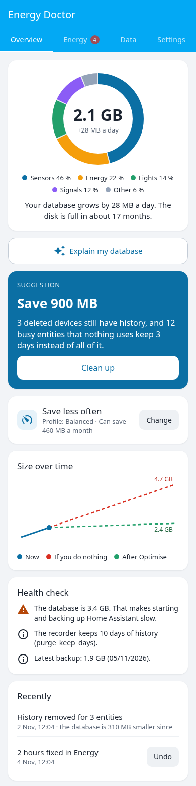
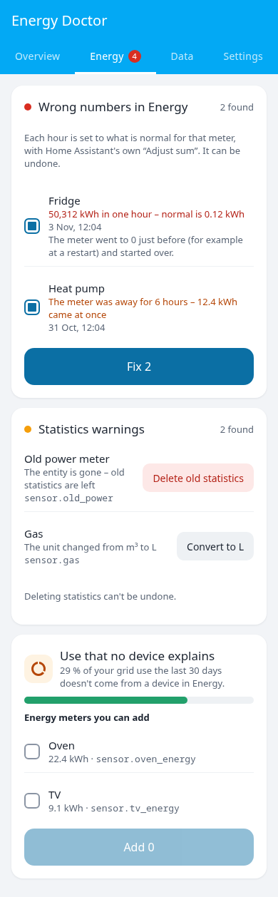
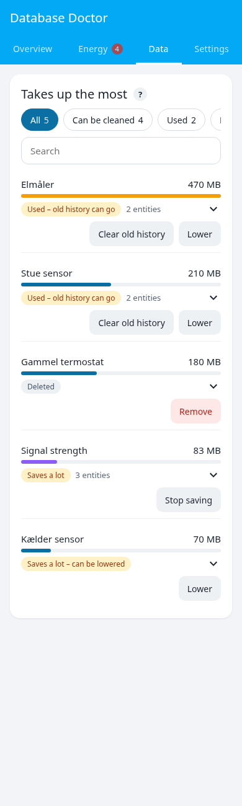
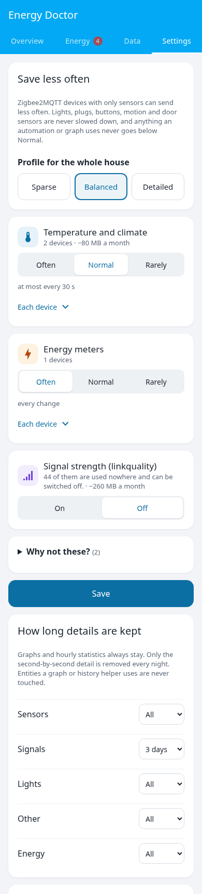

# Energy Doctor

**Your fridge used 50,000 kWh in one hour? Energy Doctor finds the wrong numbers in your energy dashboard, fixes them with one tap – and shows what fills your database and how to keep it small.**

[English](#english) · [Dansk](#dansk)

## English

Home Assistant records everything, and two things go wrong over time: a meter that resets or drops out puts absurd numbers in the energy dashboard, and the database keeps growing until Home Assistant starts and backs up slowly. Energy Doctor adds a panel to the sidebar that finds both, explains them in plain words and fixes them – only with Home Assistant's own functions, and nothing that something uses is ever touched.

### Overview

- **What fills the database** by group, how fast it grows and when the disk is full.
- **One suggestion** with how much it saves, e.g. history of devices that are gone and old history that nothing uses.
- **Size over time** with a forecast: doing nothing vs. after *Optimise*.
- **Health check:** the database on an SD card, a database so big that starting is slow, the recorder's settings and the last backup.
- **Explain with AI (optional):** pick an AI task entity under *Configure*, and the panel explains your database in plain words.

### Wrong numbers in Energy

- **Spikes and negative hours** are set to what is normal for that meter, with Home Assistant's own *Adjust sum*. The price of the same hour is fixed with it, and the panel says why the meter jumped (it was unavailable or went to 0).
- **Gaps:** when a meter was offline and everything came at once, the use is spread over the missing hours.
- **Statistics warnings** that Home Assistant shows under *Statistics* (unit changed, entity gone …) in one place, fixed with its own functions.
- **Use no device explains:** how much of your grid use the devices in Energy explain, with energy meters you can add in one tap.
- **A watch** checks twice a day and tells you about new wrong numbers. Every fix can be undone.

### What takes up the most

One row per device, with a clear status – *History used – keep*, *Used – only its value*, *Can be cleaned*, *Saves a lot* or *Deleted* – and one button that does the right thing. Tap a row to see each entity, how often it saves and where it is used: automations, scripts, scenes, graphs, dashboards, the energy dashboard, helpers and your YAML files. Filter and search when the list is long.

Energy Doctor reads how each entity is used, not just where its name appears: the YAML configuration is loaded the way Home Assistant loads it (with `!include` and packages), and only what really reads the history – graphs, the energy dashboard, `statistics`, `history_stats` and `filter` sensors, and code like AppDaemon's `get_history` – keeps the history. Automations and templates only need the value now, so their old history can go. Code in add-ons that Home Assistant can't read (for example AppDaemon on Home Assistant OS) is pointed out, and **Never touch** keeps any entity out of every suggestion.

**Stop saving** with one tap: for Zigbee2MQTT devices the value is stopped at its source (Zigbee2MQTT's own *filtered_attributes*), so nothing new is recorded and the entity keeps its last value.

### Save less often

- **Profiles for the whole house** – Sparse, Balanced, Detailed – or three levels per group: temperature and climate, energy meters, other sensors. Or a level per device, or *Never touch*.
- It uses Zigbee2MQTT's own *throttle* option, **only on devices with nothing but sensors**. Lights, plugs, buttons, motion and door sensors are never slowed down, and anything an automation or graph uses never goes below Normal. *Why not these?* lists the devices it leaves alone and why.
- **New devices** get the same automatically, and unused signal-strength (linkquality) entities can be switched off.
- **How long details are kept**, per group: e.g. 3 days of second-by-second detail – graphs and hourly statistics always stay.
- **Stop saving** an entity: Energy Doctor never changes your YAML, so it collects the lines for `configuration.yaml` for you to copy.

### Safe by design

- Data is only changed with the recorder's own functions (*Adjust sum*, import of statistics, purge) – never raw SQL.
- Fixes and changes of how often devices save can be undone. A clean-up can't, so it offers Home Assistant's own backup first.
- Your YAML files are never written.

## Installation

1. HACS → search for **Energy Doctor** → Download. (Not in HACS yet? Add `https://github.com/Clahen86/ha-energy-doctor` as a custom repository of type *Integration*.)
2. Restart Home Assistant.
3. Settings → Devices & services → Add integration → **Energy Doctor**.
4. Open **Energy Doctor** in the sidebar.

Languages: English, Danish, German, Swedish and Dutch. Early version – feedback is welcome in [issues](https://github.com/Clahen86/ha-energy-doctor/issues).

---

## Dansk

**Brugte dit køleskab 50.000 kWh på én time? Energi-doktor finder de forkerte tal i Energi-dashboardet, retter dem med ét tryk – og viser, hvad der fylder i databasen, og hvordan den holdes lille.**

Home Assistant gemmer alt, og med tiden går to ting galt: en måler, der nulstilles eller falder ud, giver skøre tal i Energi, og databasen vokser, til opstart og backup bliver langsomme. Energi-doktor er et panel i sidemenuen, der finder begge dele, forklarer dem med almindelige ord og retter dem – kun med Home Assistants egne funktioner, og det, der bruges, røres aldrig.

### Overblik

Hvad der fylder, hvor hurtigt det vokser, og hvornår disken er fuld. Ét forslag med, hvor meget det sparer, en graf med prognose (uden at gøre noget og efter *Optimer*) og et sundhedstjek. Vælger du en AI under *Konfigurer*, kan panelet forklare din database.

### Fejl i Energi

Spring og negative timer sættes til det normale for måleren med Home Assistants egen *Juster sum*, og prisen for samme time rettes med. Huller, hvor en måler var væk, fordeles over de manglende timer. Home Assistants statistik-advarsler samles ét sted, og du ser, hvor meget af forbruget enhederne i Energi forklarer. En vagt giver besked om nye fejl. Alt kan fortrydes.

### Fylder mest

Én linje pr. enhed med en klar status og én knap, der gør det rigtige. Tryk på en linje for at se hver entitet, hvor tit den gemmer, og hvor den bruges.

### Gem sjældnere

Profiler for hele huset eller niveau pr. gruppe og pr. enhed via Zigbee2MQTTs egen *throttle* – kun på enheder med rene sensorer. Lys, stik, knapper, bevægelses- og dørsensorer sættes aldrig ned, og det, der bruges, kommer aldrig under Normal. Nye enheder får det samme. Du vælger også, hvor længe detaljerne gemmes, mens grafer og timeværdier altid bliver.

### Installation

1. HACS → søg efter **Energy Doctor** → Download. (Ikke i HACS endnu? Tilføj `https://github.com/Clahen86/ha-energy-doctor` som brugerdefineret repository af typen *Integration*.)
2. Genstart Home Assistant.
3. Indstillinger → Enheder og tjenester → Tilføj integration → **Energy Doctor**.
4. Åbn **Energi-doktor** i sidemenuen.
